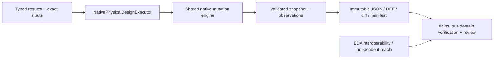

# PhysicalDesignEngine Design

## Purpose and Scope

PhysicalDesignEngine owns canonical physical state, native stage execution, and
immutable raw observations. Its current scope is deterministic geometry smoke and
characterized CTS, not production physical closure. The system ownership contract
is [LSI AGENTS.md](../AGENTS.md). Products and modules follow [Package.swift](Package.swift).

## Responsibilities and Boundaries

The package owns floorplan, power geometry, placement, CTS, routing, ECO, antenna,
fill, via and hotspot mutations; request validation; JSON/DEF interchange; and
artifact provenance. `PhysicalDesignEngine` and each stage wrapper delegate to
`NativePhysicalDesignExecutor`, which validates inputs, invokes the shared
`PhysicalDesignNativeMutationEngine`, and persists verified immutable outputs.

OpenROAD compatibility execution belongs to EDAInteroperability. PhysicalDesignEngine
neither invokes OpenROAD nor substitutes it for missing native production semantics.
ToolQualification owns tool trust; DesignFlowKernel owns approval and resume;
Xcircuite owns workspace composition. DRC, LVS, PEX and timing signoff remain with
their domain engines. Standard mask encoding belongs to swift-mask-data and its
layout integration.

## Related Designs

| Design | Relationship | Contract Used | Summary | Cautions |
|---|---|---|---|---|
| [PhysicalDesignCore](Sources/PhysicalDesignCore/DESIGN.md) | child | Exact state admission and native mutation | Component-owned bounded placement | Geometry success is separate from timing and production |
| [TimingEngine](../TimingEngine/DESIGN.md) | depends on for CTS | Strict selected-source Liberty characterization | Checked pin/cell/threshold semantics | Dependency adoption follows verified immutable lower contracts |
| [PEXEngine](../PEXEngine/DESIGN.md) | depends on for CTS | Existing passive RC material, mesh and electrodes | Physical electrical model authority | RC coefficients and calibration qualification remain separate |
| [CoreSpice](../CoreSpice/DESIGN.md) | depends on for CTS | Bounded public passive CPU transient | Existing numerical solver | No nonlinear, Metal or signoff qualification is inferred |
| [LSI architecture](../docs/platform-architecture.md) | parent system architecture | Native-primary platform ownership | Independent domain engines compose through Xcircuite | Smoke completion does not prove platform completion |
| [CircuiteFoundation](../CircuiteFoundation/DESIGN.md) | depends on | Artifact identity, diagnostics, provenance | Shared cross-domain contracts | Content identity is separate from availability |
| [LogicDesign](../LogicDesign/DESIGN.md) | depends on | Logic design reference | Exact logical input identity | Preserve input digest binding |
| [PDKKit](../PDKKit/DESIGN.md) | depends on | PDK reference | Exact process input identity | Geometry models do not prove foundry qualification |
| [EDAInteroperability](../EDAInteroperability/DESIGN.md) | coordinates with | DEF compatibility | External execution and import live outside this package | An oracle does not replace the native implementation |
| [DesignFlowKernel](../DesignFlowKernel/DESIGN.md) | used by through Xcircuite | Engine results and artifacts | Host approval and resume | The package cannot issue approval or release authorization |

## Architecture



## Contracts and Invariants

Native canonical snapshot schema 2 retains exact process source references and physical
identities. Source-bound geometry admission surrounds mutation; canonical JSON is the
resume reference. Standard DEF export is independently bounded and cannot replace
process identity, orientation or other canonical state during same-run continuation.

Request schema 7 rejects legacy schema values. Exactly one initial snapshot or
retained layout supplies the physical state. A completed mutation must pass snapshot
validation; blocked mutations publish no successful revision. Geometry, timing and
production claims remain distinct. `productionImplementation` fails with
`native_production_implementation_unsupported` until native production behavior is
implemented and verified; no caller flag or external backend may bypass this gate.

Geometry uses DBU. Source-bound CTS model selection, characterized timing units,
waveforms, failure/resource contracts and typed model observations are owned by
[ClockTreeSynthesis](Sources/PhysicalDesignCore/ClockTreeSynthesis/DESIGN.md), reached
through PhysicalDesignCore. Its schema-2 passive transient contract replaces the
legacy source-read-and-discard/length-only path using verified lower contracts.
Actual RC node waveforms own sink delay and slew evidence. Model convergence does not grant
physical signoff or production qualification.

Track direction describes the wire direction: horizontal track positions vary on
Y across core height; vertical positions vary on X across core width. Floorplan
generates tracks only when none are supplied and retains explicit tracks unchanged.
An explicit track set is authoritative for signal/ECO routing and CTS layer
selection. Eligible layers must also belong to `preferredRoutingLayers` and not
exceed `maximumRoutingLayer`. Missing directional coverage blocks execution;
an unusable explicit set must not trigger odd/even substitution. Layer parity is
only the synthetic geometry-smoke convention when no tracks exist. Configuration
validation therefore does not infer a layer's direction from its number.
Geometry-smoke CTS records the selected horizontal layer in its clock-route constraints.
Source-bound CTS layer use and numerical evidence are owned by the linked CTS design.
Re-execution identifies buffered branches by their owned output pins, replaces
the family's routes and vias, and updates those constraints to the selected layer;
it does not synthesize existing branches again as independent clock roots.
Characterized re-execution of an existing tree is currently unsupported and blocks
without artifacts. Reusing the preceding tree's estimate with a newly supplied
model must not produce a verified timing claim. Re-characterization requires
recomputing all sink paths and buffer delays from the retained tree before this
gate can be removed.
Geometry-only re-execution clears preceding timing estimates because no timing
model was evaluated for the new routes.
These direction rules compose with declared-grid admission owned by
[PhysicalDesignCore](Sources/PhysicalDesignCore/DESIGN.md). Native off-grid pin
access and bounded conductor/contact output are owned by PhysicalDesignCore through
RoutingGeometry. Complete process rules and production qualification remain separate.

Routing checks every segment against other nets on that segment's actual layer.
Coincident geometry on different layers is not a same-layer spacing violation.
Re-routing replaces both routes and vias for the selected nets and preserves
unselected nets. Every generated inter-layer bend retains its newly generated via,
even when the preceding snapshot used the same via ID. Routing evidence must describe
the retained output, not connections discarded during replacement.

Canonical Cell initialization requires explicit dimensions; fabricated 1000/10000
DBU defaults are removed. The DEF adapter accepts standard-owned LEF masters,
requires exact SIZE conversion using explicit DEF units, and rejects ambiguous,
missing or contradictory master geometry before constructing a successful snapshot.
Complete explicit dimension extensions are retained only for unqualified geometry
interchange; non-N orientation and unresolved pin/via semantics remain explicit
pending paths. [MasterGeometry](Sources/PhysicalDesignCore/MasterGeometry/DESIGN.md)
owns this construction contract.

DEF decoding keeps each supported `+ ROUTED` clause's points on its declared layer;
coordinates from later clauses cannot create connecting or zero-length segments.
The supported DEF subset is not a lossless execution-state serialization: cell pin
positions and abstract via state are not fully represented. JSON remains the full
execution-state artifact and is emitted with artifact kind `layout` so its exact
binding can be consumed by `PhysicalDesignReference` without reclassification.
This corrects the descriptor without changing content identity or snapshot bytes.
DEF route-geometry round trips do not prove via or foundry connectivity.

## Runtime Flows

```text
API / CLI / stage wrapper -> validation -> load exact snapshot -> native mutation
    -> validate output -> immutable JSON / DEF / diff / manifest -> domain verification
```

Cancellation is checked before mutation and within routing. Blocked or cancelled
mutations cannot become successful revision artifacts. A subsequent stage consumes
an exact retained state rather than an implicit latest revision.

## State, Ownership, and Lifecycle

Mutation state and DEF parser state are invocation-local values. No new shared
mutable state or target-dependent isolation is introduced. The memory artifact
store owns its dictionary in an actor; the filesystem store owns root containment,
immutable paths, digest/byte verification, and symlink rejection. Host run lifetime
and shutdown remain outside the native mutation engine.

## Failure, Concurrency, and Constraints

Malformed configuration, ambiguous inputs, invalid snapshots, routing blockages,
same-layer spacing conflicts, incomplete nets and unsupported fidelity produce
structured failures. Per-request configuration owns route width/spacing, allowed
layers, geometry and repair constraints. RoutingGeometry owns bounded source-bound
search and truthful default-width output. Source-free geometry smoke remains a limited
algorithm. Neither path establishes timing-driven or foundry-rule closure. WASM and Embedded execution are not claimed by this Foundation-based
macOS package or by macOS-only verification evidence.

Technology input preparation and declared-grid validation are specified by
[PhysicalDesignCore](Sources/PhysicalDesignCore/DESIGN.md) and its
[TechnologyConstraints component](Sources/PhysicalDesignCore/TechnologyConstraints/DESIGN.md).
Schema-7 requests and run manifests retain an explicit manifest asset ID to source
binding map (`processAssets`). ProcessInputs admits and parses these sources once
for routing and cell geometry consumers. The technology path keeps native
production blocked, and adds a direct dependency on the fixed swift-mask-data LEF
product. It consumes the shared scalar/X-Y pitch and offset representation;
horizontal tracks select Y and vertical tracks select X. The standard codec now
owns numeric arity and semantic-loss admission, so native preparation does not
repeat tokenization. Native production qualification remains independent.

[ProcessGeometry](Sources/PhysicalDesignCore/ProcessGeometry/DESIGN.md) projects
exact mapped cell pins/OBS, sites and fixed via stacks with the shared standard DEF
orientations and MaskGeometry representation. It retains signed ORIGIN, canonical
layer identity and source content references. Geometry backend range, invalid
polygons, unsupported MASK/generated-rule families and contradictory layer types
fail explicitly. Canonical geometry admission surrounds mutation and preserves exact
process identity across JSON resume. Floorplan and compatible-site placement consume
the source declarations. Bounded native row allocation and its failure/resource
contract are owned by PhysicalDesignCore through its LegalPlacement component. Explicit ECO master replacement adopts exact selected SIZE
and PORTs after matching the complete physical interface; source-free resize fails.
CTS/ECO insertion consumes exact selected buffer masters, ports and compatible sites;
source-free buffering fails. ECO split-net geometry and subsequent routing are
separate mutations. Antenna protection remains explicitly blocked until derived
post-repair feedback is implemented. Unsupported masters and unnamed vias fail output admission.
Native routing/access/CTS/ECO closure and full standard interchange
remain pending, and production capability remains independently blocked.

## Verification and Change Impact

[NativeExecutionTests](Tests/PhysicalDesignEngineTests/NativeExecutionTests.swift)
owns behavioral routing verification: reject same-layer vertical overlap, accept
different-layer crossing, preserve vias from global through detailed routing, and
reopen the actual retained multilayer DEF without geometry/layer corruption.
It also verifies non-square generated track bounds and exact JSON/DEF persistence,
explicit directions independent of parity, configured-layer restrictions and
fail-closed direction selection across signal routing, ECO rerouting and CTS.
The existing package tests cover stage prerequisites, negative inputs, cancellation,
immutable artifacts, review packets, characterized CTS and CLI failures.
[ProductionEvidenceTests](Tests/PhysicalDesignEngineTests/ProductionEvidenceTests.swift)
owns native production rejection and the release-authority boundary.

SwiftPM's `swift test` builds the CLI and test products together. CLI process tests
resolve the executable from their own `Bundle.module` resource bundle's products
directory (adjacent bundle or embedded `.xctest/Contents/Resources`), so lookup
does not depend on another test loading a bundle or an external products directory.
The timeout-bounded focused command and package command are documented in
[Fixtures/README.md](Fixtures/README.md). Build once per changed source snapshot;
`--skip-build` is only valid while that source/configuration snapshot is unchanged.
Technology CLI handoff verification runs once after the relevant changes converge.

Routing changes affect global/detailed routing and ECO re-routing through the same
shared function. DEF changes affect stored output and EDAInteroperability import.
Verify the affected behavioral tests, then the non-Metal SwiftPM package with a
process timeout. Platform signoff and independent process qualification require
separate evidence; package tests cannot establish them.

Public source-bound deterministic DEF pairing is owned by
[StandardLayoutExport](Sources/PhysicalDesignCore/StandardLayoutExport/DESIGN.md).
