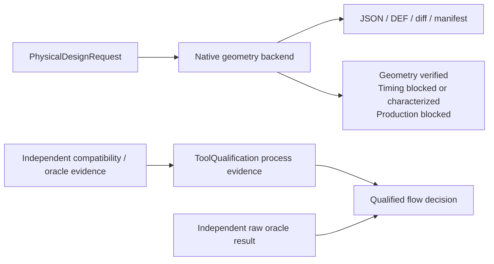

# PhysicalDesignEngine

Protocol-first floorplan, placement, clock-tree, routing, ECO, antenna-repair, and DFM contracts for Swift.

## Status

The package provides native geometry and source-bound characterized placement/CTS contracts. Native production implementation remains explicitly unsupported. External OpenROAD compatibility belongs to EDAInteroperability, not a callable backend or product in this package. The finite public-source prerequisite and exact dependency floor are defined in [DESIGN.md](DESIGN.md#public-source-prerequisite-and-dependency-alignment).



## Products

| Product | Responsibility |
|---|---|
| `PhysicalDesignCore` | Physical implementation state, standard DEF boundary, request/result, artifact I/O, timing characterization, production-evidence consumer |
| `FloorplanEngine` | Floorplan and power planning protocol |
| `PlacementEngine` | Global and detailed placement protocol |
| `CTSEngine` | Clock-tree synthesis protocol |
| `RoutingEngine` | Global and detailed routing protocol |
| `PhysicalECO` | Physical ECO protocol |
| `PhysicalDFM` | DFM mutation protocol |
| `PhysicalDesignEngine` | Native physical stage composition |
| `PhysicalDesignCLISupport` / `physical-design` | Structured JSON CLI |

## Execution contract

Every stage executor conforms directly to the `CircuiteFoundation.Engine` contract and returns `PhysicalDesignResult`. Results expose Foundation `ArtifactReference`, `DesignDiagnostic`, and `ExecutionProvenance` values without a compatibility envelope or bridge layer.

`PhysicalDesignRequest.executionIntent` distinguishes three meanings:

| Intent | Native support | Meaning |
|---|---:|---|
| `geometrySmoke` | Yes | Deterministic geometry construction and native invariant checks |
| `characterizedTiming` | Placement / CTS profiles | Characterization bound to retained process/library and applicable electrical model inputs |
| `productionImplementation` | Unsupported | Structured refusal; native production eligibility is not established |

Geometry remains in database units. `shortestPathLengthDBU`, `longestPathLengthDBU`, route constraints, and placement wirelength objectives never contain picoseconds. Clock latency and skew are emitted only as `PhysicalDesignClockTimingEstimate` after exact model, PDK, RC, cell-library, and corner artifacts have been re-read and verified. Missing characterization still permits geometry smoke output, but timing and production claims remain blocked.

## Artifacts and trust

Completed native mutations emit immutable artifacts:

| Artifact | Format | Purpose |
|---|---|---|
| `revision.json` | JSON | Internal execution state used for deterministic mutation and design diff |
| `revision.def` | DEF | Canonical physical-design interchange artifact exposed by `PhysicalDesignReference` |
| `design-diff.json` | JSON | Human/Agent review surface |
| `run-manifest.json` | JSON | Input, configuration, implementation, and revision binding |

Both artifact stores verify byte count and SHA-256. The filesystem store enforces a canonical workspace root, rejects absolute paths and symlink escapes, writes through a unique temporary file, and never replaces an immutable path.

Production trust is not issued or evaluated by this package. The engine emits
byte-bound run, corpus, implementation, and correlation artifacts;
ToolQualification consumes those raw records. Human approval, flow transition,
resume, and release policy remain outside the engine. A characterized CTS result
is not production qualification.

GDSII/OASIS stream-out is not part of this package's public execution
contract. A host composes the canonical physical result with a dedicated
standard mask-data library and evaluates that concrete exporter through
ToolQualification and release policy.

## Native limitations

The native backend does not claim foundry-rule correctness, signoff timing, DRC, LVS, PEX, EM/IR, or tapeout stream-out readiness. Native placement, routing, ECO, antenna, and DFM checks are deterministic construction checks and review candidates. Independent engines remain authoritative.

## External compatibility

OpenROAD execution is owned by EDAInteroperability. Its observations do not bypass
this package's unsupported native-production boundary. Retained production
configuration data is not a backend selector.

## CLI

From the repository root:

```bash
swift run physical-design --request Fixtures/positive-floorplan-request.json --project-root .
swift run physical-design --request Fixtures/negative-missing-snapshot-request.json --project-root .
swift run physical-design --request Fixtures/negative-native-production-request.json --project-root .
```

The CLI emits one structured `PhysicalDesignResult` JSON value.

## Build and test

`Package.swift` uses exact canonical HTTPS revisions. The complete direct source
floor and finite consuming qualification are owned by
[DESIGN.md](DESIGN.md#public-source-prerequisite-and-dependency-alignment).
A sibling checkout, edited dependency or mirror is not part of that public graph.

Use fixed Swift 6.4.0 / macOS 27 SDK and timeout-bounded SwiftPM tests. Build the
`PhysicalLogicHandoffTests` and `PhysicalDesignEngineTests` test products separately
with jobs 2. The affected prerequisite profile selects
`NormalPowerSTABindingTests|CheckedCandidatePersistenceTests` and
`CharacterizedNativeCTSTests.actualDirectCTS`; it does not claim a full package,
foundry, all-history, or release qualification. Existing geometry and other test
receipts retain their original unchanged source/graph scope.

See `DESIGN.md`, `INTERFACES.md`, `CAPABILITY.md`, and `GOAL_STATUS.md` for exact responsibility and maturity boundaries.


## Current Public Dependency Consumer

The consumer migration's exact eleven-edge public floor and finite behavioral
scope are owned by
[DESIGN.md](DESIGN.md#final-public-dependency-consumer-migration). Its qualification
passed 25 declarations / 27 expanded cases in five suites, with no skips, after
building the same public-graph CLI and test product. The selected real CLI
primary/derived CTS candidates retain JSON/DEF; each actual saved candidate is
independently functionally rechecked and bound to saved/reloaded STA. The STA
profile uses pre-route star RC plus caller-selected D-pin load, not same-routed
LVS or complete physical closure. Historical model preparation is not CLI proof.
