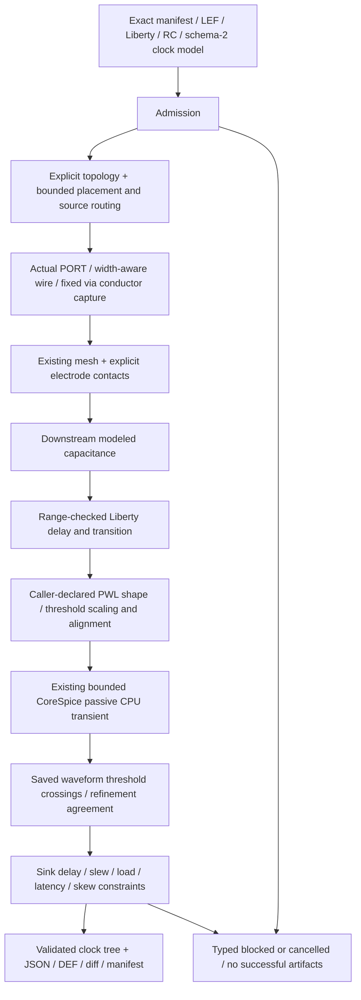

# ClockTreeSynthesis

## Purpose and Scope

Own source-bound native clock-tree candidates and characterized passive linear RC
transient observations. Parent: [PhysicalDesignCore](../DESIGN.md). No children.
This contract replaces the legacy length-only characterization using the verified
TimingEngine strict characterization and CoreSpice bounded passive CPU transient
contracts. The legacy arbitrary-byte and constant-delay execution is rejected.

## Responsibilities and Boundaries

Own exact clock identity, explicit waveform/model selection, bounded topology
construction, source geometry projection, lower-contract composition, threshold
measurement, candidate constraint admission and retained model observations.
Do not invent RC coefficients, source electrodes, clock-generation waveforms,
Liberty table values, missing corners or nonlinear cell current laws. TimingEngine
owns strict Liberty admission; PEX owns RC materials, mesh and electrodes;
CoreSpice owns transient integration and numerical solve. Physical signoff, tool
trust and foundry qualification remain separate authorities.

## Related Designs

| Design | Relationship | Contract used | Caution |
|---|---|---|---|
| [PhysicalDesignCore](../DESIGN.md) | parent | Exact request and atomic artifacts | Model computation is not signoff |
| [ProcessGeometry](../ProcessGeometry/DESIGN.md) | depends on | Selected masters, orientations, PORT/OBS and fixed via shapes | A reference pin point is not an electrode |
| [LegalPlacement](../LegalPlacement/DESIGN.md) | depends on | Occupied-interval candidates and work ceilings | Existing cell poses and identities remain fixed |
| [RoutingGeometry](../RoutingGeometry/DESIGN.md) | depends on | Width-aware source access and bounded routes | Construct the candidate before publishing its tree |
| [TimingEngine](../../../../TimingEngine/DESIGN.md) | depends on | CharacterizedTimingLibrary: selected pin capacitance, thresholds, checked four-LUT propagation | Table transition is a measured duration, not a waveform shape |
| [PEX electrical model](../../../../PEXEngine/Sources/PEXCore/ElectricalModel/DESIGN.md) | depends on | Exact SI law, PVT, calibration identities and applicability | Calibration identity does not qualify coefficients |
| [PEX mesh](../../../../PEXEngine/Sources/PEXNative/SheetExtraction/DESIGN.md) | depends on | Physical RC operators and pin incidence | Incidence alone does not impose an electrode |
| [PEX electrodes](../../../../PEXEngine/Sources/PEXNative/ElectrodeConstruction/DESIGN.md) | depends on | Explicit exposed faces and finite sheet contacts | No terminal-name-induced conductivity |
| [CoreSpice analysis](../../../../CoreSpice/Sources/CoreSpiceAnalysis/DESIGN.md) | depends on | Public strict PWL, bounded passive CPU transient, accepted time axis and checked result | No GMIN/source recovery or Metal qualification is inferred |

## Architecture

## Contracts and Invariants

The schema-2 clock model requires an explicit method, exact process/version/corner,
source asset IDs, source digests, clock roots, original sinks, topology profile,
source PWL waveforms, buffer waveform shapes, electrodes, constraints and numerical
limits. Schema 1 and its arbitrary-byte/length/constant-delay semantics are rejected.
Every selected Liberty/RC asset belongs to the exact manifest corner and matches
its retained binding by format, role, digest and byte count. RC selection retains
the exact PVT and parameter dictionary; Celsius-to-kelvin conversion is explicit.
Every calibration content identity selected by the RC model has a retained input
binding and verified bytes; this proves input integrity, not calibration accuracy.
Units are seconds, volts, farads, ohms and explicit integer DBU. No nominal corner,
unit, pin direction, buffer master or root waveform is inferred.

Every clock root has one explicit canonical output pin and at least one exact
input sink. The declared source must be the sole output of its clock net. Connected
sink pin names, directions and clock semantics agree with selected source masters
and strict Liberty. Selected sink cells require capacitance/clock admission;
selected propagation buffer cells additionally require the unique supported
combinational arc and all four checked LUTs. Unused DFF clock-to-Q/constraint arcs
cannot become evaluated CTS buffer arcs. A retained tree cannot be recharacterized
using a preceding estimate; this execution profile requires a pre-CTS snapshot.

Topology selection is explicit and finite: direct, one exact buffer per original
sink, or direct followed by that buffered candidate. The caller supplies the
buffer master whenever buffering is permitted. Distance thresholds do not select
an electrical topology. New IDs cannot collide with retained entities. Existing
cell poses/orientations, original source/sink identities and unrelated net
membership remain fixed. Buffer placement uses the existing legal allocator with
original cells locked; restored lock flags remain identical to the input.
Source routing receives only the explicit clock family, with trees unpublished.
Actual source PORT access, per-segment width and fixed via identities survive
JSON and supported standard DEF. Changed geometry invalidates preceding proofs;
unrelated evidence cannot be relabeled as fresh verification.

Conductor capture includes the generated clock wires with their actual width and
the shared [qualified endpoint footprint](../RoutingGeometry/DESIGN.md), exact transformed PORT metal, fixed via metal/cuts, and
retained modeled conductors. Pin labels do not add ideal wires. Explicit electrode
faces are expressed in the capture's DBU scale and must be covered exposed faces
of the selected source PORT/conductor; mesh refinement does not change their
physical identity. Missing, overlapping, floating, shorted, disconnected or
ambiguous terminal contacts fail. The existing PEX law and dimensional ranges
apply unchanged; no new capacitance law or aggregate via resistance is introduced.
`PhysicalDesignClockNumerics.maximumCellSpanDBU` is a positive span in the source
`PhysicalDesignSnapshot.unitsPerMicron` scale. Projection converts that span to
`capture.coordinateUnits` using the same exact positive integer capture/source
multiplier used for electrode coordinates. The checked product must fit `Int32`
before PEX mesh construction; failure is a typed model rejection. A refined
capture grid therefore preserves the caller's physical mesh resolution and does
not consume a finer-mesh transient budget merely because pin capture refines DBU.
The caller supplies electrode profiles by exact master and PORT name in the
canonical N-oriented, ORIGIN-adjusted master DBU frame. ProcessGeometry's existing
orientation/placement transform applies them to each occurrence, including newly
placed buffers. No nearest face or representative pin point selects a boundary.

The supported method is passive linear RC transient with an explicit quiet-other-
conductor boundary. Other conductors are held at the declared reference voltage;
their coupling capacitors contribute to the active network without changing their
source coefficients. Active internal capacitors retain both endpoints. Coupled
activity/crosstalk and nonlinear/CCS driver behavior are unsupported. The source
electrode is driven by its caller-supplied ideal PWL. Initial conditions explicitly
represent its settled initial level; numerical leakage or convergence recovery
cannot silently change the circuit.

Buffer composition uses the declared NLDM lumped-load approximation: output load
is the retained downstream ground/quiet-coupling capacitance plus strict Liberty
sink capacitance. Cell delay and output transition are evaluated in seconds within
all LUT axis ranges. The caller supplies distinct normalized monotonic rise/fall
PWL shapes. If their lower/upper threshold crossings are `uL` and `uU`, scale time
by `T = transitionSeconds / (uU - uL)`. Align the output-delay-threshold crossing
to the measured input-delay-threshold arrival plus the evaluated cell delay.
Scale voltage to the exact supply. This shape selection is retained, never derived
from the transition duration. Invalid shape, range, alignment or horizon fails.

CoreSpice solves the actual admitted RC circuit, not Manhattan distance or a
first-moment shift. In nodal form its passive operator is `C dv/dt + G v = b(t)`;
sheet/cut/contact resistors and both-ended capacitors are stamped by the existing
device/analysis implementation. The finite-volume resolution and numerical
integration policy are recorded. They are approximation controls, not foundry
accuracy certification.

## Runtime Flows

Admit source identity and profile -> construct a bounded topology candidate ->
place and route -> capture geometry -> extract RC and impose explicit electrodes
-> determine modeled downstream loads -> propagate cell LUT/PWL and RC waveforms
in tree order -> measure every original sink -> apply constraints -> validate and
write artifacts. An unsuccessful candidate contributes rejection evidence only.
Clock trees and timing observations are published only for the final successful
candidate after artifact writes complete.

Rise/fall arrival is the appropriate source-library/request threshold crossing on
the actual accepted node waveform; slew is its ordered lower/upper crossing
duration. Latency is relative to the original root's corresponding output-delay
threshold crossing. Latency is a signed difference when distinct input/output
thresholds are declared; a negative crossing offset is not rejected or clamped. Skew is the range of original sink arrivals for the same root
edge. Crossings use retained adjacent samples with interpolation and reject
missing, reversed or ambiguous crossings. Rise/fall loads, cell contributions,
node/terminal identity, sampled brackets and constraint margins remain inspectable.

## State, Ownership, and Lifecycle

Each invocation owns immutable admitted sources and call-local candidates, RC
graphs and waveforms. The existing artifact store owns verified reads and atomic
immutable publication. Cancellation propagates to the lower transient token and
all placement/routing/capture/measurement loops. Acquired lower device sessions
end on success, rejection, failure and cancellation. No shared cache, target-
conditional state, raw pointer ownership or separate host graph wrapper is added.

## Failure, Concurrency, and Constraints

Caller-owned model limits bound source bytes/records, topology attempts, placement
and routing candidates, capture records, mesh nodes/operators/contacts, transient
dimension, attempts, accepted points, saved scalars, work, time horizon, refinements
and measurement scans. Structural ceilings bound finite topology and existing
geometry searches; caller values may lower those ceilings. Arithmetic and
allocation products are checked before work. Lower limits are propagated rather
than reconstructed from undocumented defaults. Numerical configuration explicitly
sets time steps, voltage/current/LTE tolerances and iteration/reduction ceilings.
No-progress, minimum-step rejection, overflow and exhausted limits are typed
failures, not partial completed observations.

Refinement halves the maximum step within explicit minimum-step/refinement/work
limits. Recorded sink arrival/slew differences must meet the caller's crossing
agreement tolerance. This is numerical agreement, not a proof of absolute analytic
error. Independent representative fixtures report actual error separately.
Unsupported profiles, sources, units, corners, model ranges, shapes, terminal
conditions, unsatisfied constraints and missing crossings publish no successful
revision. Geometry/model convergence/constraint satisfaction are separate typed
observations. `claims.timing` and `claims.production` remain blocked for physical
signoff; model success does not grant foundry or tool qualification.

## Verification and Change Impact

| Invariant | Behavioral evidence owner |
|---|---|
| Real Liberty units/cap/threshold/arc semantics and no extrapolation | TimingEngine strict-characterization tests |
| Public PWL, passive RC waveform and bounded solve/cancellation | CoreSpice bounded-transient tests |
| RC material/mesh/cut/contact and exact electrical topology | Existing PEX component tests |
| Source DBU mesh span survives capture-grid refinement; span overflow rejects atomically | `CharacterizedNativeCTSTests` real projection and engine rejection tests |
| Native source-bound CTS composition | PhysicalDesignEngine ClockTreeSynthesis tests through actual API and CLI |
| Actual sink delay/slew/load/skew | Independent one-pole and two-section analytic fixtures, asymmetric Liberty tables and fanout loads |
| Missing/unknown/unsupported input and constraint failure | Actual engine typed blocked result and empty artifacts |
| Candidate and numerical limits/cancel/atomic publication | CTS tests preserving original snapshot and store state |
| JSON/DEF truth and resume boundary | Exact persisted bytes and independent standard geometry/connectivity comparison |

Reuse `.build/b5-routing`; do not introduce a new cold cache. Verify exact lower
dependency closure before compilation. Run representative cost/error checks,
focused integration, one comprehensive review plus targeted finding recheck, then
affected package verification once. Host caller/dependency adoption belongs to
Xcircuite's owner; it consumes immutable verified commits, never this working tree.

### Geometric path metadata

The characterized profile does not claim centerline path lengths through multi-area PORTs. `ClockTree.shortestPathLengthDBU` and `longestPathLengthDBU` are optional and absent in this profile. Actual routed conductor geometry and mesh identity are retained; arrival/slew/skew come exclusively from saved transient voltages. Legacy geometry smoke measurements do not become characterized timing evidence.

### Source corner and asset role admission

The request selects a PDK corner (`cornerID`) and an explicit electrical RC corner (`rcCornerID`); the latter must equal the selected PDK corner's declared `rcCorner`. Liberty and RC asset IDs must belong to that PDK corner and have `.liberty` and `.extraction` roles respectively. Electrical RC parameters are explicit, retained, and checked by the PEX owner. A PDK corner name is not silently reused as an RC corner name.

Artifact publication starts only after numerical and standard export admission and a final cancellation check. A completed result requires all written artifact bytes to be read back and verified. Store I/O failure cannot become completion; unreferenced partial run files from a multi-write I/O failure carry no successful result/manifest authority. The CTS candidate itself stays invocation-local until numerical constraints succeed.
