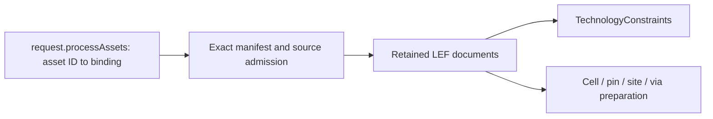

# Process Inputs

## Purpose and Scope

Resolve explicit manifest asset IDs to exact native physical inputs once per
execution. Parent: [PhysicalDesignCore](../DESIGN.md). No children.

## Responsibilities and Boundaries

Own physical source selection, manifest identity, role admission and retained LEF
documents and exact DBU conversion. TechnologyConstraints owns routing-grid projection; process geometry
preparation owns cells, pins, sites and vias. No generic technology service or
external tool execution is introduced.

## Related Designs

| Design | Relationship | Contract Used | Summary | Cautions |
|---|---|---|---|---|
| [PhysicalDesignCore](../DESIGN.md) | Parent / used by | Request, artifact store, typed errors | Native execution intake | Decode before geometry mutation |
| [ProcessGeometry](../ProcessGeometry/DESIGN.md) | Used by | Exact signed DBU conversion and admitted sources | Layer and physical shape projection | Native shape backend range is checked separately |
| [MasterGeometry](../MasterGeometry/DESIGN.md) | Used by | Exact integer DBU conversion | Master dimensions | Positive SIZE is required |
| [TechnologyConstraints](../TechnologyConstraints/DESIGN.md) | Used by | Exact source view and layer mapping | Routing-grid preparation | Do not parse the same source again |
| [PDKKit](../../../../PDKKit/DESIGN.md) | Depends on | Manifest asset IDs, roles and cross-view mapping | Process authority | Equal digests do not select an asset ID |
| [LEF](../../../../swift-mask-data/Sources/LEF/DESIGN.md) | Depends on | LEFDocument and typed reader errors | Standard semantics | Unsupported grammar fails explicitly |

## Architecture

## Contracts and Invariants

- `PhysicalDesignRequest.processAssets` maps manifest asset IDs directly to
  existing artifact bindings. Schema 6 requires the field, including an empty
  map for geometry-only smoke requests. Earlier request schemas are rejected.
- Every selected source appears in input bindings and provenance inputs. A LEF
  binding without an explicit asset selection is rejected rather than inferred
  by digest, file name or aliases.
- DBU conversion retains exact integer values below the Double exactness boundary.
  Physical coordinates permit signed values; dimensions and routing constraints
  enforce their positive/nonnegative domains. One ULP admits multiplication noise.
- The manifest binding, digest, process ID and version match the request.
  Asset digest, size and LEF format match its exact selected binding.
- Current intake admits explicit technology and cell roles. Other roles and
  formats fail explicitly; role is not guessed from document contents.
- Each source is read and parsed once. Consumers share the resulting immutable
  value view and its manifest mapping, preserving the original snapshot as the
  diff baseline.
- The request retains all selected bindings, including availability. Run
  manifests retain the asset map; later stages must supply the same exact source
  identities required by retained process state.

## Runtime Flows

Request admission -> manifest read -> source identity/role admission -> source
read/parse -> layout decode and semantic preparation -> native mutation.
Missing sources, changed identity or unsupported semantics fail before artifacts
are published. Geometry-only smoke remains explicitly unqualified.

## State, Ownership, and Lifecycle

One invocation owns manifest and parsed documents. All storage is immutable value
state; there is no shared cache, raw pointer or target-dependent synchronization.
The artifact store owns materialization and verified read semantics.

## Failure, Concurrency, and Constraints

Cancellation is checked between source reads. Work is bounded by the explicit
source map and declared artifact sizes; source views are not reparsed by each
consumer. Failed intake publishes no candidate revision.

## Verification and Change Impact

Native source tests prove explicit IDs, digest/size/process/version mismatch,
missing binding/provenance, role and syntax failures, multiple view roles and
request/run serialization. TechnologyConstraints tests prove grid composition.
Changing this request field requires updating CLI fixtures and the host stage
executor so source selection survives rebinding and resume.
