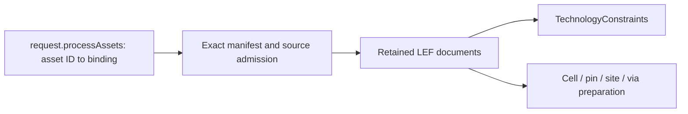

# Process Inputs

## Purpose and Scope

Resolve explicit manifest asset IDs to exact native physical inputs once per
execution. Parent: [PhysicalDesignCore](../DESIGN.md). No children.

## Responsibilities and Boundaries

Own physical source selection, manifest identity, role admission and retained LEF
documents and exact DBU conversion. TechnologyConstraints owns routing-grid projection; process geometry
preparation owns cells, pins, sites and vias. No generic technology service or
external tool execution is introduced.

## Related Designs

| Design | Relationship | Contract Used | Summary | Cautions |
|---|---|---|---|---|
| [PhysicalDesignCore](../DESIGN.md) | Parent / used by | Request, artifact store, typed errors | Native execution intake | Decode before geometry mutation |
| [ProcessGeometry](../ProcessGeometry/DESIGN.md) | Used by | Exact signed DBU conversion and admitted sources | Layer and physical shape projection | Native shape backend range is checked separately |
| [MasterGeometry](../MasterGeometry/DESIGN.md) | Used by | Exact integer DBU conversion | Master dimensions | Positive SIZE is required |
| [TechnologyConstraints](../TechnologyConstraints/DESIGN.md) | Used by | Exact source view and layer mapping | Routing-grid preparation | Do not parse the same source again |
| [PDKKit](../../../../PDKKit/DESIGN.md) | Depends on | Manifest asset IDs, roles and cross-view mapping | Process authority | Equal digests do not select an asset ID |
| [LEF](../../../../swift-mask-data/Sources/LEF/DESIGN.md) | Depends on | LEFDocument and typed reader errors | Standard semantics | Unsupported grammar fails explicitly |

## Architecture

## Contracts and Invariants

- Retained layer enclosure declarations require an exact mapped CUT layer.
  Negative overhangs remain unsupported; no zero clamp or scalar approximation
  is used. Qualified declarations require technology-role source context.
  The request-aware `requiresSourceGeometry(for:)` predicate is true when cell
  views, retained hole laws, or an explicit source-default routing width policy
  require the catalogue. Both Native composition branches and enclosure admission
  consume this single predicate. Technology-only legacy/uniform inputs without
  such a geometry profile fail explicitly for selected qualified fixed VIAs.
  Technology-only hole and source-default width profiles construct the catalogue
  and apply exact qualified enclosure to fixed geometry; existing source, SITE,
  grid and geometry admission still apply. Declarations with no applicable cut
  objects remain vacuous geometry rather than failing solely for absent cells.
  Width selection is owned by
  [TechnologyConstraints](../TechnologyConstraints/DESIGN.md#source-routing-width-policy).
  [ProcessGeometry](../ProcessGeometry/DESIGN.md#contracts-and-invariants) owns
  bottom-to-top stack identity, side selection and exact alternative evaluation.

- Antenna source admission uses the supported profile defined by
  [ProcessGeometry](../ProcessGeometry/DESIGN.md#antenna-source-projection).
  Retained antenna laws require source geometry even in technology-only inputs.
  Admission validates every selected declaration, including unmapped layers and
  cell-role views; unsupported declarations cannot disappear during mapping.
  The same admission runs before returning parsed inputs and before constructing
  ProcessGeometry from value inputs. Source admission does not evaluate antenna
  ratios or establish routed coverage; an unrouted stage has no measured pass.

- `PhysicalDesignRequest.processAssets` maps manifest asset IDs directly to
  existing artifact bindings. Schema 6 requires the field, including an empty
  map for geometry-only smoke requests. Earlier request schemas are rejected.
- Every selected source appears in input bindings and provenance inputs. A LEF
  binding without an explicit asset selection is rejected rather than inferred
  by digest, file name or aliases.
- DBU conversion retains exact integer values below the Double exactness boundary.
  Physical coordinates permit signed values; dimensions and routing constraints
  enforce their positive/nonnegative domains. One ULP admits multiplication noise.
- The manifest binding, digest, process ID and version match the request.
  Asset digest, size and LEF format match its exact selected binding.
- Current intake admits explicit technology and cell roles. Other roles and
  formats fail explicitly; role is not guessed from document contents.
- Each source is read and parsed once. Consumers share the resulting immutable
  value view and its manifest mapping, preserving the original snapshot as the
  diff baseline.
- The request retains all selected bindings, including availability. Run
  manifests retain the asset map; later stages must supply the same exact source
  identities required by retained process state.

Database precision resolution is owned by this input bundle. Explicit DATABASE
values in selected technology views must agree; otherwise the standalone standard
100 is used. Incremental technology/cell views without a DATABASE declaration
inherit that unique technology context. An explicit cell precision must match;
no asset enumeration order selects or overrides units. Output DBU must not be
finer and must divide source precision exactly. Numerical source coordinates stay
in microns; precision declarations are not applied as physical scale multipliers.
[LEF Units](../../../../swift-mask-data/Sources/LEF/Codec/DESIGN.md) owns syntax and
presence facts. Native projection must preserve its chosen output coordinate frame.

USEMINSPACING OBS interpretation is resolved from all exact selected technology
and cell declarations. One explicit ON or OFF controls the bundle; absent cell
facts inherit that context. All-absent means the standard ON. Contradictory explicit
policies fail; source order, file names and snapshot metadata cannot override it.

## Runtime Flows

Request admission -> manifest read -> source identity/role admission -> source
read/parse -> layout decode and semantic preparation -> native mutation.
Missing sources, changed identity or unsupported semantics fail before artifacts
are published. Geometry-only smoke remains explicitly unqualified.

## State, Ownership, and Lifecycle

One invocation owns manifest and parsed documents. All storage is immutable value
state; there is no shared cache, raw pointer or target-dependent synchronization.
The artifact store owns materialization and verified read semantics.

## Failure, Concurrency, and Constraints

Cancellation is checked between source reads. Work is bounded by the explicit
source map and declared artifact sizes; source views are not reparsed by each
consumer. Failed intake publishes no candidate revision.

## Verification and Change Impact

Native source tests prove explicit IDs, digest/size/process/version mismatch,
missing binding/provenance, role and syntax failures, multiple view roles and
request/run serialization. TechnologyConstraints tests prove grid composition.
Changing this request field requires updating CLI fixtures and the host stage
executor so source selection survives rebinding and resume.

[DatabasePrecisionTests](../../../Tests/PhysicalDesignEngineTests/DatabasePrecisionTests.swift)
owns inherited/explicit/conflicting/coarser/finer/nondivisible source/output API
and actual CLI behavior, exact JSON/DEF persistence and same-source resume.

Native property capability admission scans every selected layer, including layers
not mapped for routing. Only the recognized LEF58_TYPE STRING classification
NWELL/PWELL on MASTERSLICE is admitted here. It preserves the codec-derived
subtype and raw source facts; it does not establish well spacing or manufacturing
qualification. Unknown layer property assignments, other subtype families and
library definition values fail before mutation or artifact publication. Schema-only
definitions without values do not apply process rules. Both complete geometry and
technology-only execution use this same input admission. This source admission verifies
mapped well classifications against nonrouting manifest layers with purpose well.

[LayerPropertyAdmissionTests](../../../Tests/PhysicalDesignEngineTests/LayerPropertyAdmissionTests.swift) owns source-capability rejection and actual API/CLI saved JSON/DEF/resume verification.

[AntennaCapabilityAdmissionTests](../../../Tests/PhysicalDesignEngineTests/AntennaCapabilityAdmissionTests.swift)
owns mapped/unmapped/cell/technology-only API and actual CLI refusal with no
candidate artifacts, direct geometry-construction refusal, and unchanged
antenna-free source admission. Full antenna evaluation remains a separate goal.

## Fixed VIA Layer Classification

`PhysicalDesignFixedViaStack` classifies a fixed VIA's three distinct source layer
references by the admitted canonical LEF types and exact manifest mapping. Exactly
two ROUTING layers and one CUT layer are required; the source VIA LAYER statement
order does not assign these roles. The existing positive manifest layer numbers
order the two routing layers. Qualified ENCLOSURE retains its independent canonical
technology-source adjacency check. No separate physical stack order is invented.

Projection preserves every original rectangle/polygon and its original layer.
Duplicate declarations, unmapped layers, repeated layers and contradictory CUT or
routing roles fail before geometry publication. Fixed-master names remain exact.
An unused VIARULE GENERATE formula remains retained nonexecuted source information;
a formula name does not replace an explicitly declared fixed VIA of the same name.
Generated VIA materialization remains unsupported.

[FixedViaSelectionTests](../../../Tests/PhysicalDesignEngineTests/FixedViaSelectionTests.swift)
owns CUT-first/source-order permutations, invalid typed stacks, actual DEFAULT
selection and exact API/CLI persistence. The ProcessGeometry owner composes this
helper before its existing cut-width/spacing/contact/enclosure/grid validation.
